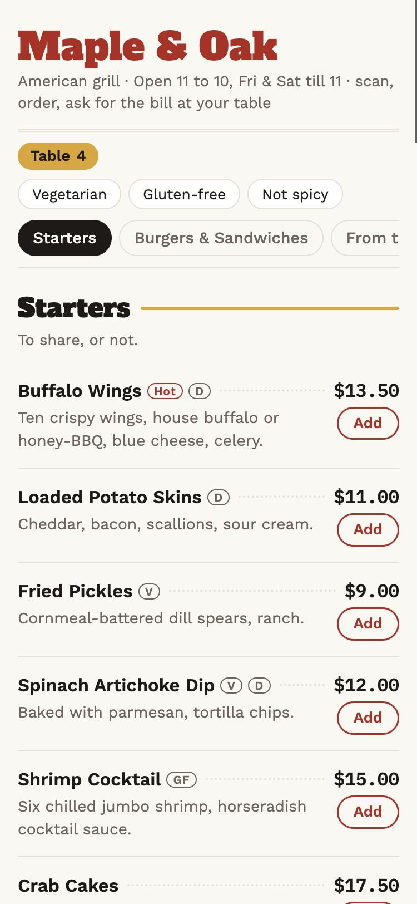
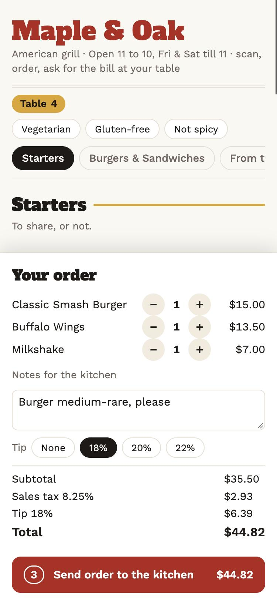
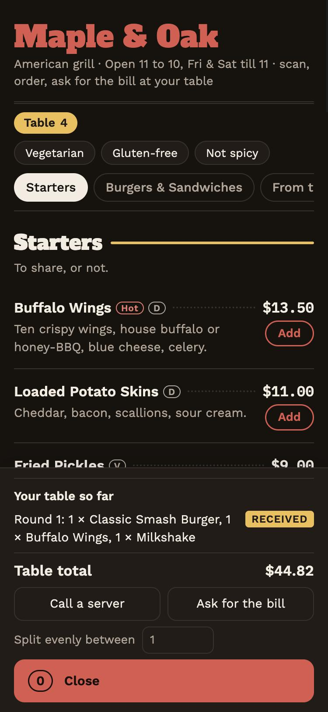
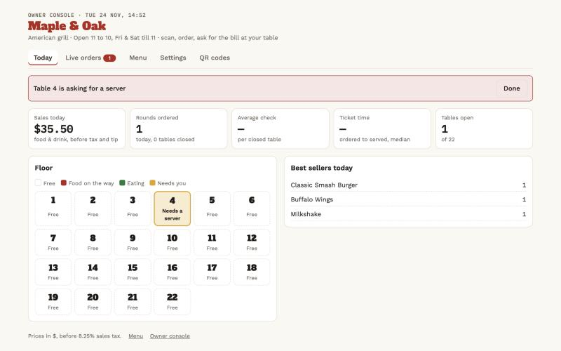
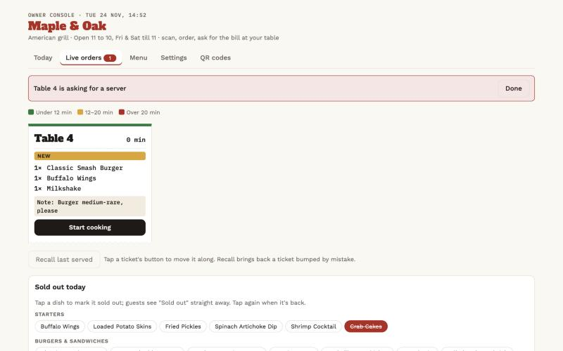
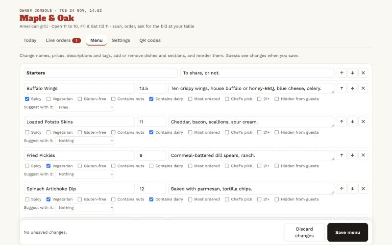

# Maple & Oak: QR table ordering and restaurant analytics

A phone ordering menu for a sit-down restaurant, an owner console to run service from, and a set of Python scripts that analyse a restaurant's year: menu profit, demand forecasting, staffing, supplier prices, reviews and waste.

It ships with a sample restaurant, **Maple & Oak**, an 84-seat American grill. Point it at your own `restaurant.json` and both the menu and the analysis describe your restaurant instead.

<p>
  
  
  
</p>

<p>
  
</p>

> **Sample data.** The year of orders, reviews, waste, rota and supplier prices behind the analysis is simulated. Nothing in this repository is a real restaurant's data.

## What's inside

| Folder | What it is |
|---|---|
| [`menu/menu.html`](menu/menu.html) | The guest menu and the owner console, in one self-contained page |
| [`analysis/`](analysis) | Python scripts that simulate a year of trading and analyse it. Standard library only |
| [`dashboard/index.html`](dashboard/index.html) | The analytics dashboard page that charts the analysis output |
| [`restaurant.example.json`](restaurant.example.json) | The sample restaurant's setup: menu, tables, tax, tips, branding |
| [`test/build_menu_test.py`](test/build_menu_test.py) | Builds a local copy of the menu with an in-memory database, for testing changes |
| [`docs/screenshots/`](docs/screenshots) | The images in this README |

## The menu and owner console

**Guests** scan the QR code on their table. The menu opens with the table number already set. They can:

- browse by section and filter to vegetarian, gluten-free or not spicy
- see dietary codes on every dish (V, GF, N for nuts, D for dairy, Hot, 21+) with a key at the bottom
- add dishes, get a suggested pairing ("Goes well with Onion Rings"), add a note for the kitchen and pick a tip
- send the order, then watch each round move from received to cooking to served
- call a server, ask for the bill and split the total evenly

**Owners and staff** open the same page with `#owner` on the end of the link. Only people with edit access see the console.

| Tab | What it does |
|---|---|
| Today | Alerts for tables that want the bill or a server, sales so far, rounds ordered, average check, median ticket time, a colour-coded floor map and today's best sellers |
| Live orders | One kitchen ticket per round, oldest first. Each ticket turns amber, then red, as it waits. Tap **Start cooking**, then **Served**; **Recall** undoes a mistake. Tap any dish under **Sold out today** and guests see "Sold out" straight away |
| Menu | Rename dishes and sections, change prices, descriptions and tags, hide a dish, reorder with arrows and pick a pairing to suggest. Nothing changes for guests until you save |
| Settings | Restaurant name, tagline, hours, tables, seats, sales tax, tip choices, currency, brand colour (with a readability check), ticket timer thresholds, the note under the menu and the menu's own link. Export and import the whole setup as `restaurant.json` |
| QR codes | One printable card per table |

<p>
  
</p>
<p>
  
</p>

### Where it runs

`menu/menu.html` is built as a [Claude artifact](https://support.anthropic.com/). It uses three services the claude.ai artifact runtime provides through `claude.use(...)`:

| Service | Used for |
|---|---|
| `db` | Storing the menu setup, each table's orders, kitchen statuses and closed tables, with live updates |
| `user` | Knowing who is viewing, so each guest sees only their own table and only editors see the console |
| `downloads` | Exporting `restaurant.json` |

To run your own copy, publish `menu/menu.html` as an artifact (ask Claude to publish it), then follow **Set up your restaurant** below. Opening the file straight in a browser shows the menu, but ordering and the console need those services.

**Running it outside Claude.** The page talks to the database in a handful of places, all through `db.doc(path)` and `db.collection(path)` with `get`, `set`, `update`, `delete`, `where` and `onSnapshot`. That maps closely onto Firebase Firestore. To host it yourself, replace the `claude.use("db")` and `claude.use("user")` calls near the bottom of the page with your own database and sign-in, and keep the same paths:

| Path | Holds | Who can read / write |
|---|---|---|
| `config/restaurant` | Menu and settings | everyone / editors |
| `orders/{guestId}` | One guest's open tab: table, rounds, bill and help requests | that guest and editors |
| `status/{guestId}` | Kitchen status for each of that guest's rounds | that guest / editors |
| `history/{id}` | Closed, paid tables | editors |

### Set up your restaurant

1. **Publish your copy** of `menu/menu.html` and open it with `#owner` on the end of the link.
2. **Paste the page's link** into **Settings → This menu's link**. The QR codes point there.
3. **Load your menu.** Edit it in the **Menu** tab, or write a `restaurant.json` (start from [`restaurant.example.json`](restaurant.example.json)) and use **Settings → Import a file**. Check it, then save the menu and the settings.
4. **Print the QR codes** from the **QR codes** tab, one per table.
5. **Share the page.** Give staff edit access and guests the lowest access that lets them place orders.

Payments are taken by staff on a card reader. The page does not take cards.

### `restaurant.json`

```json
{
  "name": "Taco Shed", "tagline": "Street tacos", "hours": "Open 11 to 9",
  "tables": 8, "seats": 30, "taxRate": 9.5, "currency": "$",
  "tipOptions": [0, 15, 20], "defaultTip": 15, "accent": "#8a1c3a",
  "timerWarn": 10, "timerLate": 18, "notice": "Ask about allergens.",
  "menuLink": "https://claude.ai/artifact/your-copy",
  "sections": [
    { "name": "Tacos", "blurb": "Two per order", "items": [
      { "id": "pastor", "name": "Al Pastor", "price": 4.5, "desc": "Pork, pineapple, onion",
        "tags": ["gf", "hot"], "suggest": "horchata", "soldOut": false, "hidden": false,
        "cost": 1.2, "prepMin": 6, "popularity": 14 }
    ] }
  ]
}
```

- **Tags:** `hot`, `veg`, `gf`, `nuts`, `dairy`, `popular`, `chef`, `21+`. Unknown tags are dropped on import.
- **`suggest`:** the `id` of another dish to offer when this one is added.
- **`cost`, `prepMin` and `popularity`:** read only by the analysis scripts. They are ingredient cost per plate, minutes to cook and a relative ordering weight (the sample's dishes run from 1 to 20).

## The analysis

Python 3.9 or later, nothing to install. From the repository root:

```bash
python3 analysis/generate.py actual && python3 analysis/generate.py nochange && python3 analysis/generate.py plan
```

```bash
python3 analysis/analyze.py
```

It takes about ten seconds and writes JSON for the dashboard to `analysis/out/`.

**`generate.py`** simulates a year of trading from the QR menu's point of view: every party's seating, order, kitchen and payment times, what they ordered, prep and plate waste, the staff rota, two suppliers' weekly quotes and online reviews. On 6 July a set of changes goes live. It runs three ways:

| Run | What it shows |
|---|---|
| `actual` | The year with the 6 July changes |
| `nochange` | The same guests and weeks with no changes, so the season can be taken out of before-and-after comparisons |
| `plan` | The changes plus a recommended second round of fixes, as a projection |

**`analyze.py`** produces:

- **Menu engineering:** each dish's popularity and margin within its menu section, classed as Star, Plowhorse, Puzzle or Dog.
- **Demand forecast:** daily covers for the next four weeks. It uses whichever of seasonal naive, additive or multiplicative Holt-Winters had the lowest error over four rolling holdout windows.
- **Staffing:** servers and cooks needed per hour against the rota, plus a proposed rota.
- **Suppliers:** spend per ingredient, price drift over the year, and what switching to the cheaper quote would save.
- **Reviews:** themes and sentiment from keyword rules that read the review text, scored against the simulator's own tags.
- **Waste:** over-production and plate waste by week and by dish.
- **Effect and plan:** the season-free effect of the changes, and the projected effect of the next round.

**Your own restaurant.** Copy `restaurant.example.json` to `restaurant.json` at the repository root and edit it, or export one from the owner console. The simulation then uses your tables, seats and menu:

- Guests, kitchen capacity and staff scale with the number of tables.
- Dishes the sample knows keep their cost and popularity. New dishes use a 30% food cost unless the file says otherwise.
- Every role keeps at least one person per shift, so very small restaurants show high labour cost.

Without a `restaurant.json`, the scripts reproduce the sample exactly.

**Real orders.** `analysis/sync_qr_orders.py <folder>` reads an export of the menu's `orders` and `history` documents and writes `analysis/data/qr_order_lines.csv`. The next `analyze.py` run then fills the dashboard's QR orders tab.

### The dashboard

`dashboard/index.html` is written for Claude's Dashboard artifact type. It reads the JSON files in `analysis/out/` as attached datasets. Replace `YOUR-MENU-ID` in its links with your menu's link before uploading it.

## Testing the menu locally

```bash
python3 test/build_menu_test.py
```

```bash
python3 -m http.server 8767 --directory test
```

Then open `http://localhost:8767/menu_test.html?as=owner#owner` for the console, or `?as=guest#table-4` for a guest at table 4. The test page swaps the artifact services for an in-memory database, so everything resets on reload.

## Limitations

- Guests need access to the published artifact to order. A public website would need the database swap described above.
- No card payments, kitchen printers or point-of-sale connection.
- Bills split evenly only, not by item.
- One restaurant per copy. There is no multi-location view and no delivery orders.
- The analysis runs on simulated history until real orders accumulate. The forecast, staffing and supplier sections need a real point-of-sale export to say anything about a real restaurant.

## License

[MIT](LICENSE)
